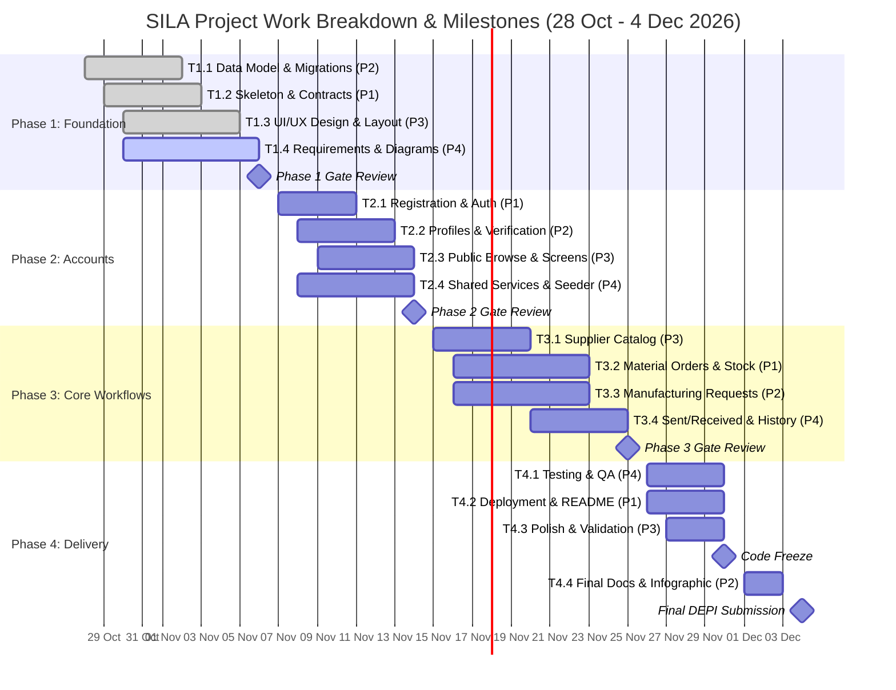

<!--
═══════════ HANDOFF ═══════════════════════════════════
Task:        T1.4 | Owner: P4 (QA & Business Analyst) | Status: DONE
What exists: Comprehensive Project Planning, Team Structure, Agile/Kanban Methodology, Sprints Table, Risk Management Matrix, Measurable KPIs, and Mermaid Gantt Chart.
What is left: // TODO(T4.1): Use planning KPIs and acceptance criteria for QA test plan.
              // TODO(T4.4): Reuse sprint metrics and planning documentation for final graduation report.
Depends on:  T1.1 (Data Model & Schema), T1.2 (Solution Skeleton & Tasks)
Used by:     All team members (P1, P2, P3, P4), DEPI Supervisors & Instructors
How to test: Review against DEPI Planning & Project Management grading criteria; verify dates (28 Oct - 4 Dec 2026), 4 sprints, WIP limits, and Gantt milestones.
Notes:       Dates match actual academic timeline with code freeze on 30 Nov 2026 and final submission on 4 Dec 2026.
═══════════════════════════════════════════════════════
-->

# SILA (صِلة) — Project Planning & Management Document

> **Document:** Project Plan, Agile Methodology, Sprints & Gantt Chart  
> **Task:** T1.4 | **Owner:** P4 (QA & Business Analyst)  
> **Project Track:** Digital Egypt Pioneers Initiative (DEPI) — Full Stack .NET  
> **Academic Supervisors:** DEPI Instructors & Mentors ("the Eng.")  
> **Last Updated:** 29 October 2026  

---

## 1. Project Background & Academic Nature

**SILA (صِلة)** is a specialized B2B web platform engineered for the Egyptian fashion and apparel supply chain. It acts as a digital bridge between three core industrial stakeholders:
1. **Brand Owners:** Local apparel and fashion designers seeking reliable manufacturers and raw fabrics.
2. **Factory Owners:** Apparel production plants managing manufacturing capacity and quoting requests.
3. **Suppliers:** Fabric and raw material vendors listing catalogs with real-time stock and fixed pricing.

### Academic Framework
- **Track:** DEPI (Digital Egypt Pioneers Initiative) — Full Stack .NET Track.
- **Project Type:** University graduation capstone project & academic demonstration.
- **Team Size:** 4 Software Engineers.
- **Budget:** 0 EGP (utilizing free-tier services, LocalDB/Express SQL Server, and open-source libraries).
- **Core Milestones:**
  - **Project Kickoff:** 28 October 2026
  - **Phase 1 (Foundation & Design) Deadline:** 6 November 2026
  - **Implementation Code Freeze:** 30 November 2026
  - **Final Project Submission & Presentation:** 4 December 2026

---

## 2. Team Structure & Roles

The team operates under Agile/Scrum principles with dual responsibilities balancing leadership, engineering, and quality assurance:

| Person ID | Primary Role | Scrum / Project Role | Primary Ownership Areas |
|---|---|---|---|
| **P1** | Lead Backend Engineer | **Scrum Master / Coordinator** | Solution Architecture, ASP.NET Core Identity, Auth & Email (T2.1), Material Orders & Stock Engine (T3.2), Hosting & Deployment (T4.2) |
| **P2** | Database Engineer | **Data Architect** | Data Model & EF Core Migrations (T1.1), Profiles & Verification (T2.2), Manufacturing Requests & Negotiations (T3.3), Final Documentation (T4.4) |
| **P3** | Frontend Engineer | **UI/UX Designer** | Wireframes & Shared Layout (T1.3), Public & Browse Pages (T2.3), Supplier Catalog (T3.1), UI Polish & Responsive Testing (T4.3) |
| **P4** | QA & Business Analyst | **Product Owner Proxy / Shared Services** | Planning & Requirements (T1.4), Shared Infrastructure Services (T2.4), Sent/Received & Dashboards (T3.4), Comprehensive Testing & QA (T4.1) |

---

## 3. Agile / Kanban Development Methodology

### 3.1 Framework Overview
Due to the strict 5-week timeframe and 4-person team, SILA employs a **Hybrid Agile/Kanban Methodology** with 4 defined Sprints (Phases). Development is conducted **in parallel using contract-first engineering**:

```
[Phase Gate N-1 Approved]
          │
          ├──> P1: Feature Branch (T*.1) ──┐
          ├──> P2: Feature Branch (T*.2) ──┼──> [Peer Review PR] ──> [develop Integration]
          ├──> P3: Feature Branch (T*.3) ──┤                               │
          └──> P4: Feature Branch (T*.4) ──┘                               ▼
                                                                [Phase Gate Review]
                                                                           │
                                                                           ▼
                                                                [Tag release on main]
```

### 3.2 Key Agile Practices
1. **Contract-First Parallelism:**
   - Tasks do not wait for complete upstream implementations. Interfaces (`Services/Interfaces/`), Data Enums (`Models/Enums/`), and Entity models are established early (Phase 1).
   - Developers code against interfaces using temporary stubs marked `// TODO(Tx.y): replace stub`.
2. **Cadence & Ceremonies:**
   - **Standup Meetings:** Held every two days (15 minutes): What was completed, what is planned next, and blockers.
   - **Phase Gate Reviews:** At the conclusion of each sprint, the Team Lead verifies clean compilation, successful migration execution against a clean database, seeder execution, and acceptance criteria before merging into `develop` and tagging `main`.
   - **Retrospectives:** Conducted at the end of Phases 1, 2, and 3 to refine task estimations and address workflow bottlenecks.
3. **Task Board & WIP Limits:**
   - GitHub Projects Kanban Board structure:
     `Backlog` ➔ `To Do` ➔ `In Progress` ➔ `In Review` ➔ `Testing` ➔ `Done`
   - **Strict WIP (Work In Progress) Limit:** Maximum **2 tasks In Progress per developer** simultaneously to prevent context switching and incomplete branches.
4. **Git Branching Strategy:**
   - `main`: Production-ready, stable codebase tagged at each milestone (`phase-1-complete`, etc.).
   - `develop`: Shared integration branch for active phase code.
   - `feature/T<phase>-<n>-<short-name>`: Individual task branches (e.g., `feature/T1-4-requirements-design`).
   - Direct commits to `main` or `develop` are prohibited; all changes require Pull Requests with at least one peer approval.

---

## 4. Sprints & Phases Schedule

The project spans 5 continuous weeks partitioned into 4 distinct phases:

| Sprint / Phase | Dates | Milestone / Focus | Key Deliverables | Phase Gate Criteria |
|---|---|---|---|---|
| **Phase 1: Foundation & Design** | 28 Oct – 6 Nov | System Architecture & Design Specification | - Data Model, ERD, Schema Description (T1.1)<br>- Project Skeleton & Service Contracts (T1.2)<br>- UI Wireframes, Layout & CSS (T1.3)<br>- Planning, Requirements & UML Diagrams (T1.4) | `develop` compiles; clean database migrates; seeder runs; DEPI Design requirements satisfied. |
| **Phase 2: Accounts & Shared Services** | 7 Nov – 14 Nov | Identity, Verification & Cross-Cutting Infrastructure | - User Registration & Email Confirmation (T2.1)<br>- Profiles, Document Upload & Admin Review (T2.2)<br>- Public Browse & Role Dashboards (T2.3)<br>- Ownership, Notifications & History Services (T2.4) | End-to-end user registration, email verification, document upload, and Admin verification working on clean clone. |
| **Phase 3: Core Workflows** | 15 Nov – 25 Nov | Business Logic & Workflow Realization | - Supplier Catalog Management (T3.1)<br>- Material Orders & Atomic Stock Engine (T3.2)<br>- Manufacturing Requests & Counter-Offers (T3.3)<br>- Sent/Received & Unified Dashboards (T3.4) | Both workflows function end-to-end; atomic stock test passes; negative stock impossible; record-level auth verified. |
| **Phase 4: Hardening & Delivery** | 26 Nov – 4 Dec | Quality Assurance, Deployment & Final Reporting | - Comprehensive QA, Concurrency & Security Tests (T4.1)<br>- Deployment, Backup/Restore & README (T4.2)<br>- UI Polish & Accessibility (T4.3)<br>- Final User Manual, Tech Docs, PPT & Infographic (T4.4) | Code freeze on 30 Nov; zero critical defects; hosted live demo active; all DEPI deliverables published. |

---

## 5. Gantt Chart (Project Timeline)



---

## 6. Risk Management Matrix

| Risk ID | Description | Impact | Probability | Mitigation Strategy | Owner |
|---|---|---|---|---|---|
| **R-01** | **Tight Academic Schedule:** 5-week timeframe with multiple academic commitments. | High | High | Fixed scope boundaries (Part 3.3 Out of scope). Prioritize core requirements; defer non-essential cosmetic features. | P1 (Lead) |
| **R-02** | **Database Migration Conflicts:** Concurrent modifications to EF Core migrations across 4 local machines. | Critical | Medium | **Single Database Owner rule:** Only P2 creates and updates migrations. All schema changes requested via GitHub issues. | P2 |
| **R-03** | **Inventory Race Conditions (Overselling):** Concurrent orders placing demand higher than available fabric quantity. | Critical | Medium | SQL Server check constraint `AvailableQuantity >= 0`, `RowVersion` concurrency token, and atomic transaction confirmation in `IMaterialOrderService`. | P1 & P2 |
| **R-04** | **Data Isolation & Security Breach:** User viewing or modifying requests/orders belonging to other organizations. | High | Low | Centralized `IOwnershipService` enforcement on every server-side endpoint. Rigorous negative authorization test suites in T4.1. | P4 |
| **R-05** | **Uneven Workload / Team Illness:** A developer unable to complete assigned tasks on schedule. | High | Medium | Cross-functional backup pairing: P1 backs up P2; P3 backs up P4. Granular tasks with small PR sizes. | All |
| **R-06** | **Unreliable Brand Verification:** Difficulty verifying authenticity of brand accounts automatically. | Low | High | Formally documented as an academic working decision (D-12): manual admin review of submitted links/portfolios. | P4 |
| **R-07** | **Secret Leaks into Git:** Accidentally committing database passwords or SMTP credentials. | Critical | Low | Comprehensive `.gitignore` for appsettings secrets; mandatory usage of `dotnet user-secrets` on local dev environments. | P1 |
| **R-08** | **Environment Drift:** Code working on one machine failing on another due to missing dependencies. | Medium | Medium | Automated database seeding (`DbSeeder.cs`); detailed step-by-step setup documentation in `README.md`. | P1 |
| **R-09** | **Scope Creep (Payments / Shipping):** Team tempted to add online payments or shipping tracking. | Medium | Low | Explicitly banned by Section 3.3. Focus remains on core B2B discovery, request negotiation, and order placement. | P4 |
| **R-10** | **Deployment Failure on Demo Day:** Cloud hosting downtime or database connection timeout during presentation. | Critical | Low | Prepare fully tested offline LocalDB/Express fallback deployment on the demonstration laptop prior to presentation. | P1 & P4 |

---

## 7. Quality Objectives & Measurable KPIs

To ensure academic and technical excellence, the following Key Performance Indicators (KPIs) are tracked and audited:

1. **Server-Side Validation Coverage:** 100% of all incoming requests validated on the server using DataAnnotations + domain service validation.
2. **Defect Threshold at Release:** **0 critical or high-severity bugs** open at code freeze (30 Nov 2026).
3. **Response Time:** 95% of standard web requests execute in **< 3.0 seconds** under a seeded dataset (≥50 listings, ≥100 orders, ≥20 requests, 10 simulated concurrent users).
4. **Data Integrity:** 0 instances of negative inventory permitted under concurrent load simulations.
5. **Cross-Browser Compatibility:** 100% functional consistency across Google Chrome and Microsoft Edge on standard viewports (1920×1080, 1366×768, 768×1024).
6. **Task Board Health:** Zero tasks remaining in `In Progress` status at phase gate reviews; all pull requests reviewed by at least one teammate.

