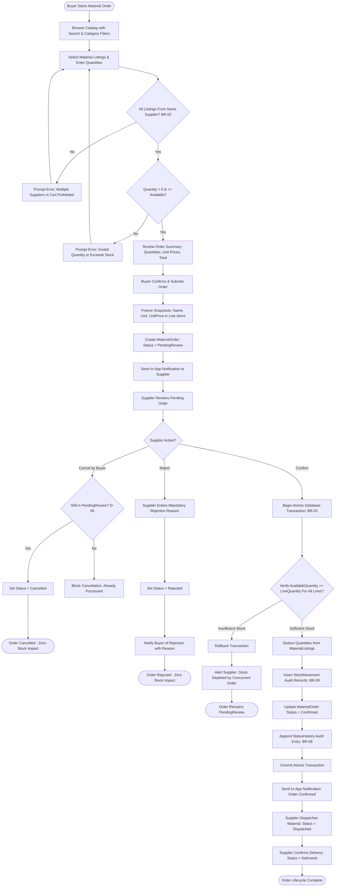
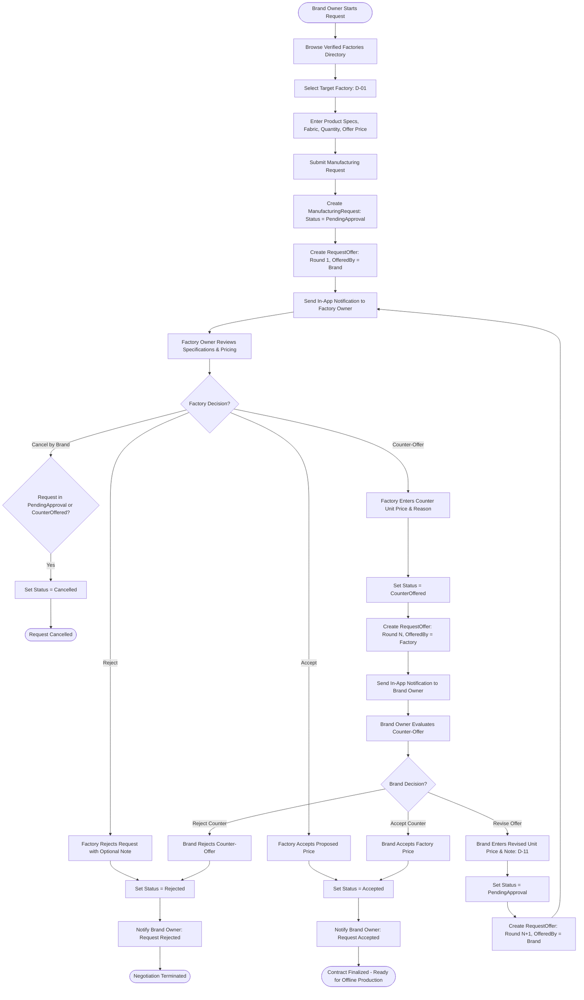

<!--
═══════════ HANDOFF ═══════════════════════════════════
Task:        T1.4 | Owner: P4 (QA & Business Analyst) | Status: DONE
What exists: Three comprehensive Mermaid Activity Diagrams covering (1) Registration & Verification, (2) Material Ordering with Atomic Concurrency Control, and (3) Manufacturing Request with Multi-Round Negotiation.
What is left: // TODO(T4.1): Formulate integration tests mapping directly to activity decision branches.
Depends on:  T1.1 (Data Model & Schema), T1.2 (Service Contracts)
Used by:     All developers (P1, P2, P3, P4), QA Testers
How to test: Verify alignment with D-01..D-12, BR-03 (atomic confirmation), BR-05 (snapshot preservation), and D-11 (unbounded counter-offers).
Notes:       All activity paths detail database transaction boundaries and rollback scenarios.
═══════════════════════════════════════════════════════
-->

# SILA (صِلة) — Activity Diagrams

> **Document:** Business Process & Operational Activity Models  
> **Task:** T1.4 | **Owner:** P4 (QA & Business Analyst)  
> **Target System:** SILA B2B Apparel Platform  
> **Last Updated:** 29 October 2026  

---

## 1. Activity Diagram 1: Account Registration & Verification Workflow

Models the complete user onboarding process from role declaration through email confirmation, document submission, and administrative review:

```mermaid
flowchart TD
    Start([User Starts Registration]) --> SelectRole[Select Organization Type: Brand, Factory, or Supplier]
    SelectRole --> FillForm[Fill Profile: Name, Email, Password, Phone, Org Name]
    FillForm --> SubmitReg[Submit Registration Form]

    SubmitReg --> CheckValid{Server Validation & Unique Email?}
    CheckValid -- No --> ShowRegError[Display Validation Errors to User]
    ShowRegError --> FillForm

    CheckValid -- Yes --> CreateUser[Create ApplicationUser & Organization]
    CreateUser --> SetUnverified[Set VerificationStatus = Unverified]
    SetUnverified --> SendEmail[Generate Token & Send Confirmation Email via SMTP]
    SendEmail --> EmailSentPage[Display: 'Check Your Email To Confirm']

    EmailSentPage --> ClickLink[User Clicks Confirmation Link in Email]
    ClickLink --> ValidateToken{Token Valid & Not Expired?}
    ValidateToken -- No --> TokenError[Display Token Error / Resend Option]
    ValidateToken -- Yes --> ConfirmEmail[Set EmailConfirmed = True]
    ConfirmEmail --> LoginScreen[User Logs In]

    LoginScreen --> CheckRole[Determine Organization Type Requirements]
    
    CheckRole --> UploadDocs[User Uploads Role-Specific Verification Proofs]
    note1[Brand: Instagram/Portfolio link<br>Factory: Industrial License<br>Supplier: Commercial Registration] -.-> UploadDocs
    
    UploadDocs --> ValidateFiles{Valid MIME Type & Size <= 5MB?}
    ValidateFiles -- No --> FileError[Reject Upload & Prompt Valid Format]
    FileError --> UploadDocs

    ValidateFiles -- Yes --> SaveDocs[Store Documents Outside Git]
    SaveDocs --> UpdateStatus[Set VerificationStatus = PendingReview]
    UpdateStatus --> AdminQueue[Submission Listed in Admin Portal]

    AdminQueue --> AdminReview[Admin Inspects Proofs & Organization Details]
    AdminReview --> AdminDecision{Admin Decision?}
    
    AdminDecision -- Reject --> AdminNoteReject[Enter Mandatory Rejection Reason]
    AdminNoteReject --> SetRejected[Set VerificationStatus = Rejected]
    SetRejected --> NotifyUserReject[Send In-App Notification with Reason]
    NotifyUserReject --> EndReject([Account Restricted to Profile View])

    AdminDecision -- Approve --> AdminNoteApprove[Optional Approval Note]
    AdminNoteApprove --> SetVerified[Set VerificationStatus = Verified]
    SetVerified --> NotifyUserApprove[Send In-App Notification: 'Account Verified']
    NotifyUserApprove --> EndApprove([Full System Capabilities Unlocked])
```

---

## 2. Activity Diagram 2: Material Order & Atomic Stock Execution

Models order drafting, single-supplier partition enforcement, snapshot recording, and transactional concurrency handling during confirmation:

---

## 3. Activity Diagram 3: Manufacturing Request & Negotiation Rounds

Models the complete multi-round bargaining lifecycle between a Brand Owner and a targeted Factory Owner:

