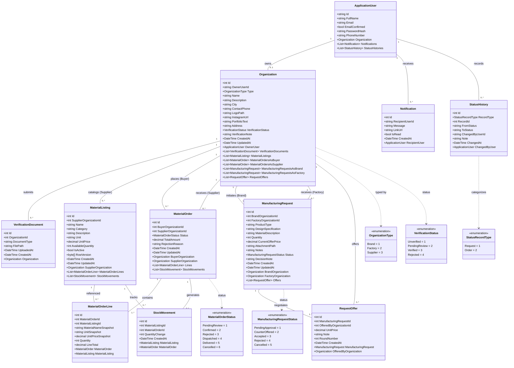

<!--
═══════════ HANDOFF ═══════════════════════════════════
Task:        T1.4 | Owner: P4 (QA & Business Analyst) | Status: DONE
What exists: Comprehensive Domain Class Diagram (Mermaid classDiagram) and detailed structural descriptions of all entities, enums, relationships, attributes, and data constraints, strictly matching T1.1 physical schema.
What is left: // TODO(T4.1): Formulate unit tests validating entity constraints, relationships, and foreign key cascades.
Depends on:  T1.1 (Models/Entities/*, Models/Enums/*, ApplicationDbContext)
Used by:     All developers (P1, P2, P3, P4)
How to test: Verify that every entity property, type, and relationship matches Models/Entities/* in src/SILA.Web/.
Notes:       All decimal fields are typed as decimal(18,2) in EGP. Concurrency token RowVersion is placed on MaterialListing.
═══════════════════════════════════════════════════════
-->

# SILA (صِلة) — Domain Class Diagram

> **Document:** Domain Model & Object-Oriented Class Specifications  
> **Task:** T1.4 | **Owner:** P4 (QA & Business Analyst)  
> **Target Framework:** Entity Framework Core 8.0 / C# 12  
> **Last Updated:** 29 October 2026  

---

## 1. Domain Model Overview

The SILA object model is structured around Clean MVC principles. Domain entities encapsulate database persistence and navigational relationships. Financial values are strictly represented as `decimal(18,2)` in Egyptian Pounds (EGP). All entities maintain a `CreatedAt` audit timestamp, with mutable business records featuring `UpdatedAt`.

---

## 2. Mermaid Class Diagram

---

## 3. Structural Integrity & Relationship Analysis

1. **User to Organization Mapping (1:1):** `ApplicationUser` owns exactly one `Organization` via a unique foreign key index on `OwnerUserId`.
2. **Snapshot Immutability (BR-04):** `MaterialOrderLine` references `MaterialListingId` as a foreign key (`DeleteBehavior.Restrict`), but stores frozen snapshots of name, unit, and unit price. Deleting or modifying a catalog listing has zero retrospective impact on past orders.
3. **Concurrency Token (`RowVersion`):** `MaterialListing` includes a SQL Server timestamp/rowversion byte array column (`RowVersion`) mapped as `[Timestamp]`. During `IMaterialOrderService.ConfirmOrderAsync`, EF Core verifies that the row has not changed between reading available stock and executing deduction.
4. **Non-Negative Stock Constraint (BR-01):** Physical SQL constraint `CHECK (AvailableQuantity >= 0)` guarantees that simultaneous orders cannot force stock negative.
5. **Polymorphic Status Audit Logging (BR-08):** `StatusHistory` references either a `ManufacturingRequest` or a `MaterialOrder` using the pair `(RecordType, RecordId)`, accompanied by immutable actor references and timestamps.

