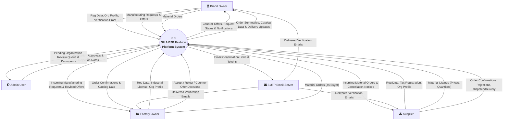
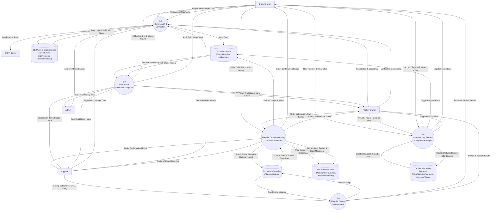

<!--
═══════════ HANDOFF ═══════════════════════════════════
Task:        T1.4 | Owner: P4 (QA & Business Analyst) | Status: DONE
What exists: Data Flow Diagrams (DFD) including Context Level 0 Diagram and Level 1 Functional Decomposition Diagram with external entities, processes, data stores, and data flows.
What is left: // TODO(T4.1): Formulate boundary data-flow security tests verifying D1..D5 store isolation.
Depends on:  T1.1 (Data Model & Schema), T1.2 (Service Contracts)
Used by:     All developers (P1, P2, P3, P4), Academic Reviewers
How to test: Verify data store mappings (D1..D5) match physical SQL Server tables; verify external entities match glossary.
Notes:       Process boundaries clearly isolate Material Orders from Manufacturing Requests.
═══════════════════════════════════════════════════════
-->

# SILA (صِلة) — Data Flow Diagrams (DFD)

> **Document:** Context Diagram (Level 0) & Detailed DFD (Level 1)  
> **Task:** T1.4 | **Owner:** P4 (QA & Business Analyst)  
> **Academic Initiative:** DEPI — Full Stack .NET Track  
> **Last Updated:** 29 October 2026  

---

## 1. Context Diagram (DFD Level 0)

The Level 0 Context Diagram depicts the boundaries of the SILA platform, showing external actors and the major information flows exchanged with the centralized system:

---

## 2. Level 1 Data Flow Diagram (Process Decomposition)

The Level 1 DFD decomposes the system into five core functional sub-processes interacting with five centralized data stores:

---

## 3. Data Dictionary & Store Definitions

| Store ID | Physical Entity Mapping | Description & Governance |
|---|---|---|
| **D1** | `AspNetUsers`, `Organizations`, `VerificationDocuments` | Stores account credentials, hashed passwords, contact details, organization type, and uploaded verification files. Governed by `IVerificationService`. |
| **D2** | `MaterialListings` | Catalog of fabrics and materials. Enforces concurrency token (`RowVersion`) and check constraint `AvailableQuantity >= 0`. Governed by `IMaterialListingService`. |
| **D3** | `MaterialOrders`, `MaterialOrderLines`, `StockMovements` | Contains frozen point-in-time order lines, statuses, totals in EGP, and immutable stock deduction records. Governed by `IMaterialOrderService`. |
| **D4** | `ManufacturingRequests`, `RequestOffers` | Stores garment manufacturing contracts, target factory references, specs, and complete multi-round price negotiation history. Governed by `IManufacturingRequestService`. |
| **D5** | `StatusHistories`, `Notifications` | Append-only system audit ledger recording all state transitions across both workflows (BR-08) and targeted user alerts (BR-10). Governed by `IStatusHistoryService` and `INotificationService`. |

