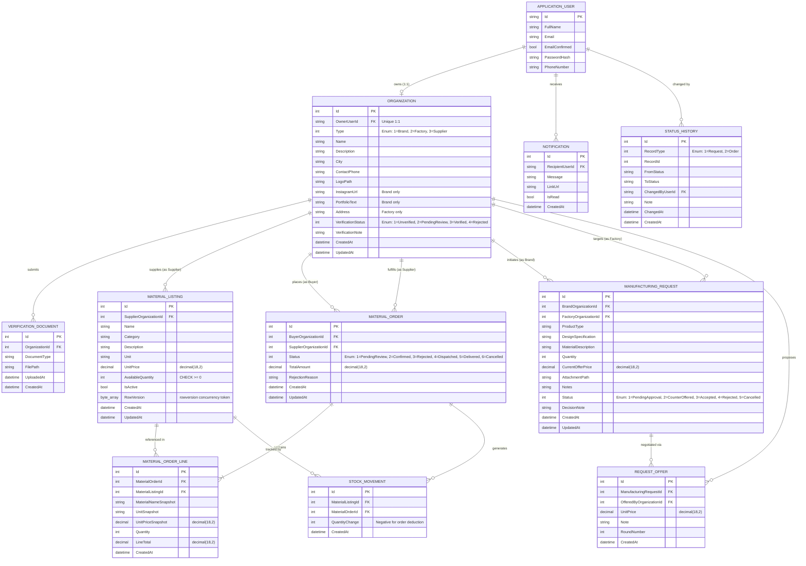

# SILA (صِلة) — Entity Relationship Diagram (ERD)

> **Document:** Entity Relationship Diagram (Conceptual, Logical & Physical Relationships)  
> **Task:** T1.1 | **Owner:** P2 (Database Engineer)  
> **Status:** APPROVED & MATCHED TO CODE (ApplicationDbContext v1)  
> **Last Updated:** 29 October 2026  

---

## 1. Overview & Core Data Model Principles

SILA is a B2B platform tailored for the Egyptian fashion industry, connecting three primary organization types: **Brand Owner**, **Factory Owner**, and **Supplier**, with an internal lightweight **Admin** for account verification.

### Core Architectural Rules Reflected in ERD:
1. **One Organization per User Account:** `ApplicationUser` has a strict 1-to-1 relationship with `Organization`.
2. **Two Isolated Lifecycles:**
   - **Manufacturing Request Workflow:** Connects `Brand` with `Factory` (`ManufacturingRequest` + `RequestOffer` rounds). Completely isolated from material inventory.
   - **Material Order Workflow:** Connects `Buyer` (Brand or Factory) with `Supplier` (`MaterialOrder` + `MaterialOrderLine` + `StockMovement`).
3. **Data Immutability & Snapshots:** Order lines store frozen snapshots (`MaterialNameSnapshot`, `UnitSnapshot`, `UnitPriceSnapshot`) to guarantee historic fidelity against future catalog edits.
4. **Auditability & Traceability:** Every status change writes an immutable `StatusHistory` record. Stock deductions write `StockMovement` records atomically.

---

## 2. Mermaid Entity Relationship Diagram

---

## 3. Relationship Cardinality & Integrity Rules

| Source Entity | Target Entity | Cardinality | Foreign Key | Delete Rule | Description |
|---|---|---|---|---|---|
| `AspNetUsers` | `Organizations` | 1 — 0..1 | `Organizations.OwnerUserId` | **RESTRICT** | Each user account owns exactly one business profile; organization cannot be orphaned. |
| `Organizations` | `VerificationDocuments` | 1 — 0..* | `VerificationDocuments.OrganizationId` | **RESTRICT** | Proof documents submitted during verification review. |
| `Organizations` | `MaterialListings` | 1 — 0..* | `MaterialListings.SupplierOrganizationId` | **RESTRICT** | Material catalog listings owned by a Supplier organization. |
| `Organizations` | `MaterialOrders` | 1 — 0..* | `MaterialOrders.BuyerOrganizationId` | **RESTRICT** | Orders submitted by a Buyer (Brand or Factory). |
| `Organizations` | `MaterialOrders` | 1 — 0..* | `MaterialOrders.SupplierOrganizationId` | **RESTRICT** | Orders fulfilled by a Supplier. All lines must belong to this supplier (BR-02). |
| `MaterialOrders` | `MaterialOrderLines` | 1 — 1..* | `MaterialOrderLines.MaterialOrderId` | **RESTRICT** | One or more items purchased in a single order. |
| `MaterialListings` | `MaterialOrderLines` | 1 — 0..* | `MaterialOrderLines.MaterialListingId` | **RESTRICT** | Historical link. Deletion blocked (BR-05); listings are deactivated instead. |
| `MaterialListings` | `StockMovements` | 1 — 0..* | `StockMovements.MaterialListingId` | **RESTRICT** | Audit trail of inventory reductions. |
| `MaterialOrders` | `StockMovements` | 1 — 0..* | `StockMovements.MaterialOrderId` | **RESTRICT** | Trace which confirmed order produced which stock reduction. |
| `Organizations` | `ManufacturingRequests` | 1 — 0..* | `ManufacturingRequests.BrandOrganizationId` | **RESTRICT** | Production request submitted by a Brand. |
| `Organizations` | `ManufacturingRequests` | 1 — 0..* | `ManufacturingRequests.FactoryOrganizationId` | **RESTRICT** | Target factory selected by the Brand (D-01). |
| `ManufacturingRequests` | `RequestOffers` | 1 — 0..* | `RequestOffers.ManufacturingRequestId` | **RESTRICT** | Offer and counter-offer negotiation rounds. |
| `Organizations` | `RequestOffers` | 1 — 0..* | `RequestOffers.OfferedByOrganizationId` | **RESTRICT** | Party that proposed the unit price for this round. |
| `AspNetUsers` | `Notifications` | 1 — 0..* | `Notifications.RecipientUserId` | **RESTRICT** | Targeted in-app alerts for state-changing events. |
| `AspNetUsers` | `StatusHistories` | 1 — 0..* | `StatusHistories.ChangedByUserId` | **RESTRICT** | User who executed the status transition. |
