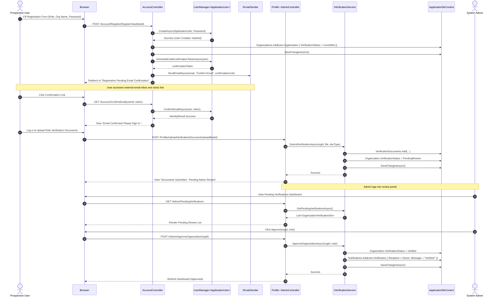
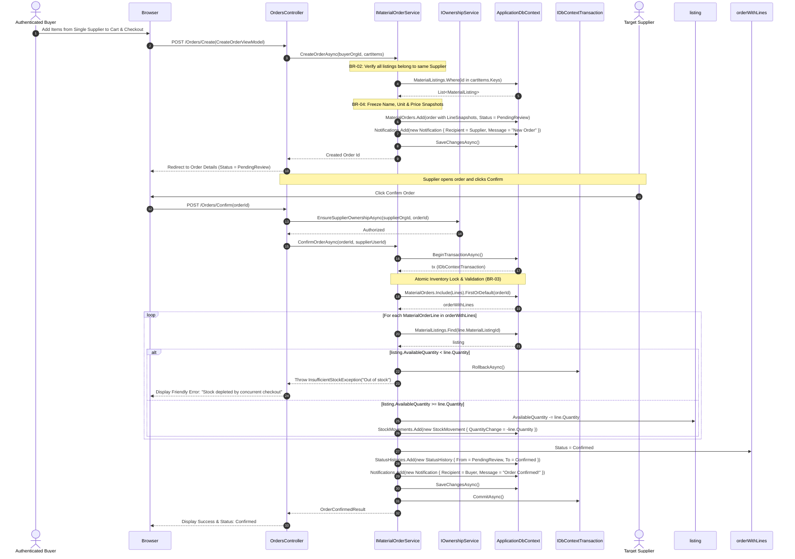
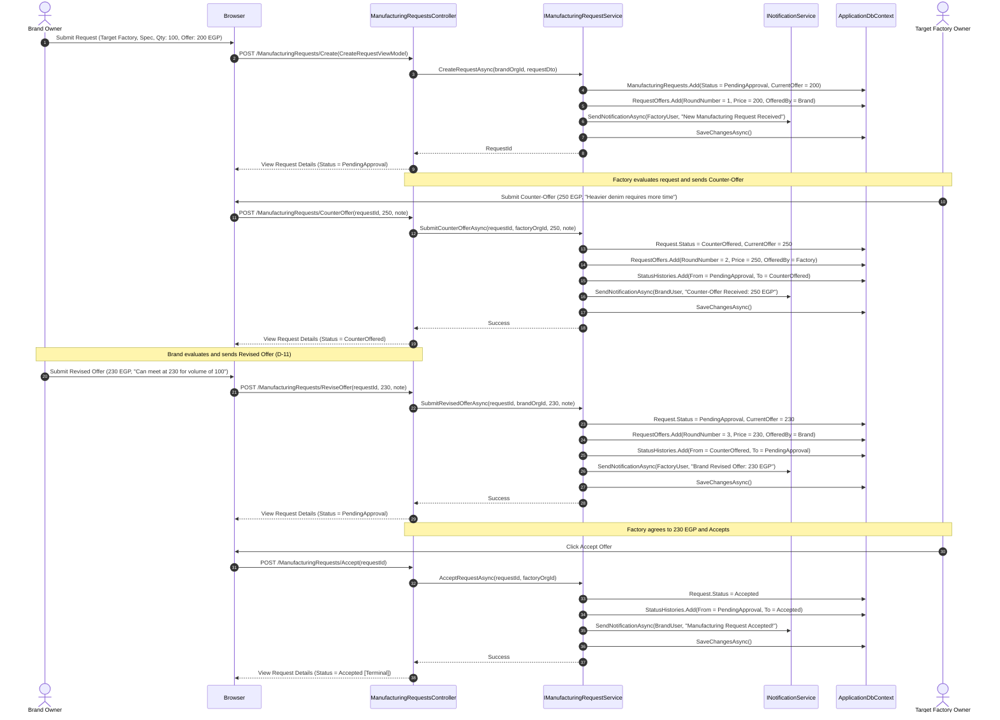

<!--
═══════════ HANDOFF ═══════════════════════════════════
Task:        T1.4 | Owner: P4 (QA & Business Analyst) | Status: DONE
What exists: Three comprehensive Mermaid Sequence Diagrams modeling (1) User Registration, Email Confirmation & Admin Verification, (2) Material Order Placement & Atomic Stock Confirmation with RowVersion Concurrency Token, and (3) Manufacturing Request Multi-Round Negotiation.
What is left: // TODO(T4.1): Use sequence interactions to write end-to-end integration test mocks and assertions.
Depends on:  T1.1 (Data Model & Schema), T1.2 (Service Contracts)
Used by:     P1 (T2.1, T3.2), P2 (T2.2, T3.3), P4 (T2.4, T4.1)
How to test: Verify exact method signatures and transaction boundaries (IDbContextTransaction, CommitAsync, RollbackAsync); verify snapshot creation and audit logging.
Notes:       All interactions strictly separate UI Controllers from Service Business Logic.
═══════════════════════════════════════════════════════
-->

# SILA (صِلة) — Sequence Diagrams

> **Document:** Component Interaction & Object Sequence Models  
> **Task:** T1.4 | **Owner:** P4 (QA & Business Analyst)  
> **Academic Initiative:** DEPI — Full Stack .NET Track  
> **Last Updated:** 29 October 2026  

---

## 1. Sequence Diagram 1: Registration, Email Confirmation & Admin Verification

Models user onboarding, SMTP verification link issuance, document upload, and administrative approval:

---

## 2. Sequence Diagram 2: Material Order Placement & Atomic Supplier Confirmation

Models order placement with frozen snapshots, followed by atomic stock verification, rowversion concurrency check, inventory deduction, and audit logging during confirmation:

---

## 3. Sequence Diagram 3: Manufacturing Request Negotiation Lifecycle

Models request submission, factory counter-offer, brand offer revision, and final factory acceptance:

