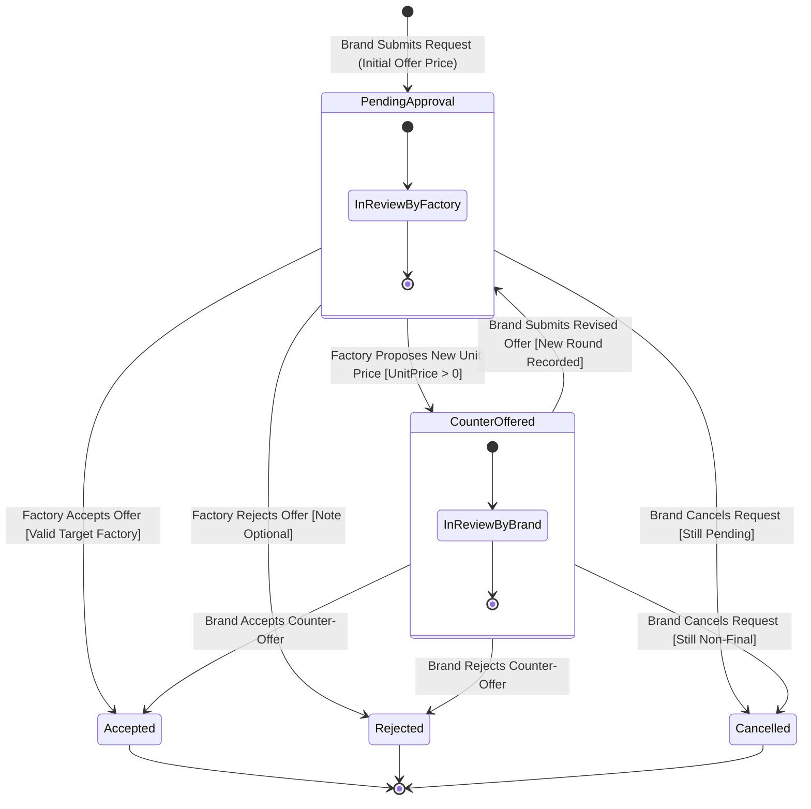
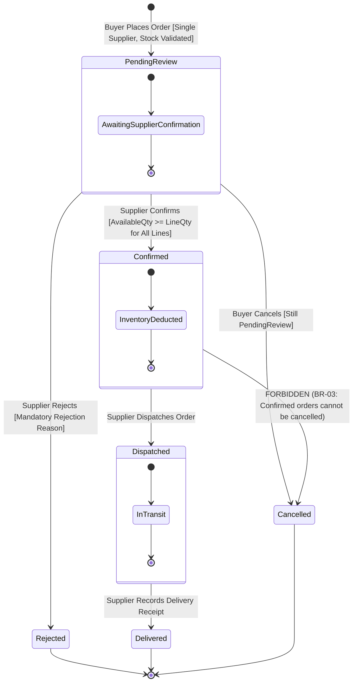

<!--
═══════════ HANDOFF ═══════════════════════════════════
Task:        T1.4 | Owner: P4 (QA & Business Analyst) | Status: DONE
What exists: Formal State Machine Diagrams (Mermaid stateDiagram-v2) for both isolated workflows: (1) Manufacturing Request Lifecycle and (2) Material Order Lifecycle, strictly matching Enums in Part 6.2 and tables in Parts 4.3 and 4.4.
What is left: // TODO(T3.2): Implement MaterialOrderStatus transitions in MaterialOrderService.
              // TODO(T3.3): Implement ManufacturingRequestStatus transitions in ManufacturingRequestService.
Depends on:  T1.1 (Enums in Models/Enums/), T1.2 (Service Contracts)
Used by:     P1 (T3.2), P2 (T3.3), P4 (T4.1 QA Tests)
How to test: Verify that no cross-workflow transitions exist; verify terminal states; verify that confirmed material orders cannot transition to cancelled.
Notes:       All transitions write to StatusHistory (BR-08) and trigger Notifications (BR-10).
═══════════════════════════════════════════════════════
-->

# SILA (صِلة) — State Transition Diagrams

> **Document:** State Machine Specifications & Transition Guards  
> **Task:** T1.4 | **Owner:** P4 (QA & Business Analyst)  
> **Academic Initiative:** DEPI — Full Stack .NET Track  
> **Last Updated:** 29 October 2026  

---

## 1. Overview of Workflow Isolation

As established in Section 1.4 of the SILA Architecture Baseline, SILA enforces **two completely distinct, non-overlapping lifecycles**:
1. **Manufacturing Request Lifecycle:** Governs custom production contracts negotiated between Brand and Factory.
2. **Material Order Lifecycle:** Governs off-the-shelf fabric transactions executed between Buyer and Supplier.

These lifecycles never share database records, status enumerations, transition rules, or inventory side-effects.

---

## 2. Manufacturing Request State Machine

### 2.1 State Enumeration: `ManufacturingRequestStatus`
- `PendingApproval` (1): Request awaiting review by the target Factory Owner.
- `CounterOffered` (2): Factory proposed a revised unit price; awaiting response from the Brand Owner.
- `Accepted` (3): Proposal accepted by either party. Terminal state.
- `Rejected` (4): Proposal declined by either party. Terminal state.
- `Cancelled` (5): Request retracted by the initiating Brand Owner while non-final. Terminal state.

### 2.2 Mermaid State Diagram

### 2.3 Transition Truth Table (Enforced in `IManufacturingRequestService`)

| Source State | Destination State | Permitted Actor | Required Condition / Input | Inventory Effect |
|---|---|---|---|---|
| `(None)` | `PendingApproval` | Brand Owner | Valid target factory (Verified), Quantity > 0, OfferPrice > 0 | None |
| `PendingApproval` | `Accepted` | Factory Owner | Request in `PendingApproval`, user owns target factory | None |
| `PendingApproval` | `Rejected` | Factory Owner | Request in `PendingApproval`, optional decision note | None |
| `PendingApproval` | `CounterOffered` | Factory Owner | Request in `PendingApproval`, new `UnitPrice > 0` | None |
| `CounterOffered` | `Accepted` | Brand Owner | Request in `CounterOffered`, user owns brand | None |
| `CounterOffered` | `Rejected` | Brand Owner | Request in `CounterOffered`, user owns brand | None |
| `CounterOffered` | `PendingApproval` | Brand Owner | Request in `CounterOffered`, new `UnitPrice > 0` (revised round) | None |
| `PendingApproval` | `Cancelled` | Brand Owner | Request in `PendingApproval`, user owns brand | None |
| `CounterOffered` | `Cancelled` | Brand Owner | Request in `CounterOffered`, user owns brand | None |
| *Any Other* | *Any Other* | *Any* | **ILLEGAL TRANSITION** ➔ Throws `InvalidOperationException` | None |

---

## 3. Material Order State Machine

### 3.1 State Enumeration: `MaterialOrderStatus`
- `PendingReview` (1): Order submitted by Buyer; awaiting stock confirmation by Supplier.
- `Confirmed` (2): Supplier approved order; inventory atomically decremented. Non-cancellable.
- `Rejected` (3): Supplier declined order with mandatory explanation. Terminal state.
- `Dispatched` (4): Supplier packed and shipped material.
- `Delivered` (5): Material physically received by Buyer. Terminal state.
- `Cancelled` (6): Retracted by Buyer prior to confirmation. Terminal state.

### 3.2 Mermaid State Diagram

### 3.3 Transition Truth Table (Enforced in `IManaterialOrderService`)

| Source State | Destination State | Permitted Actor | Precondition & Concurrency Rule | Inventory Transaction Effect |
|---|---|---|---|---|
| `(None)` | `PendingReview` | Buyer (Brand / Factory) | Single supplier (BR-02), quantities $\le$ available | Verified only; zero stock deduction |
| `PendingReview` | `Confirmed` | Supplier | Supplier owns listing; `AvailableQuantity >= LineQuantity` for **all** lines within transaction (BR-03) | **Atomically deducted; writes `StockMovement` (BR-09)** |
| `PendingReview` | `Rejected` | Supplier | Supplier owns listing; mandatory non-empty reason provided | Zero stock effect |
| `PendingReview` | `Cancelled` | Buyer | Buyer owns order; status is strictly `PendingReview` (D-06) | Zero stock effect |
| `Confirmed` | `Dispatched` | Supplier | Order is currently `Confirmed` | Zero stock effect |
| `Dispatched` | `Delivered` | Supplier | Order is currently `Dispatched` | Zero stock effect |
| `Confirmed` | `Cancelled` | *Any* | **STRICTLY PROHIBITED** | Not allowed |

