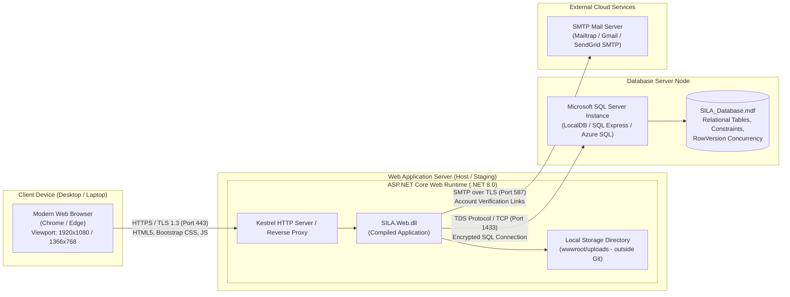

<!--
═══════════ HANDOFF ═══════════════════════════════════
Task:        T1.4 | Owner: P4 (QA & Business Analyst) | Status: DONE
What exists: Comprehensive System Architecture, Component Diagram, Deployment Diagram, and Technology Stack Evaluation & Justification.
What is left: // TODO(T4.2): Validate deployment diagram during cloud/local staging setup.
Depends on:  T1.1 (Data Model & Schema), T1.2 (Solution Skeleton & Interfaces)
Used by:     All developers (P1, P2, P3, P4), Academic Evaluators
How to test: Review against Section 5 of SILA_PROJECT_CONTEXT.md; verify 3-tier MVC with Services layer; verify exact NuGet package constraints.
Notes:       Architecture strictly mandates thin controllers and thick domain services.
═══════════════════════════════════════════════════════
-->

# SILA (صِلة) — System Architecture, Component & Deployment Models

> **Document:** Software Architecture, Component Breakdown & Physical Deployment  
> **Task:** T1.4 | **Owner:** P4 (QA & Business Analyst)  
> **Framework:** ASP.NET Core 8.0 MVC / EF Core / SQL Server  
> **Academic Initiative:** DEPI — Full Stack .NET Track  
> **Last Updated:** 29 October 2026  

---

## 1. Architectural Style & Layering

SILA is architected as an **Enterprise MVC with a Decoupled Services Layer** packaged within a unified web application. This architecture ensures high cohesion, loose coupling, and strict maintainability within the academic project constraints:

```
┌─────────────────────────────────────────────────────────────┐
│                      Presentation Layer                     │
│  (Razor Views, ViewModels, Thin ASP.NET Core Controllers)   │
└──────────────────────────────┬──────────────────────────────┘
                               │ Injects & Dispatches
                               ▼
┌─────────────────────────────────────────────────────────────┐
│                        Services Layer                       │
│  (Business Logic, Concurrency, State Machines, Auth Checks) │
│                                                             │
│   ┌───────────────────────────────┐  ┌───────────────────┐  │
│   │ Domain Workflow Services      │  │ Shared Services   │  │
│   │ - IMaterialOrderService       │  │ - IOwnershipSvc   │  │
│   │ - IManufacturingRequestSvc    │  │ - INotificationSvc│  │
│   │ - IMaterialListingService     │  │ - IStatusHistory  │  │
│   │ - IOrganizationService        │  │ - IVerificationSvc│  │
│   └───────────────┬───────────────┘  └─────────┬─────────┘  │
└───────────────────┼────────────────────────────┼────────────┘
                    │                            │
                    ▼                            ▼
┌─────────────────────────────────────────────────────────────┐
│                      Data Access Layer                      │
│ (EF Core 8.0, ApplicationDbContext, Code-First Migrations)  │
└──────────────────────────────┬──────────────────────────────┘
                               │ SQL TDS Protocol
                               ▼
┌─────────────────────────────────────────────────────────────┐
│                       Database Layer                        │
│ (Microsoft SQL Server LocalDB / Express, RowVersion, Check) │
└─────────────────────────────────────────────────────────────┘
```

### Architectural Principles:
1. **Thin Controllers:** Controllers only validate `ModelState`, extract current user/organization identities, delegate business logic to services, and return Views or Redirects.
2. **Encapsulated Business Logic:** All state transitions, atomic stock deductions, ownership checks, and audit logging live entirely inside domain services.
3. **Decoupled Contracts:** Service interfaces (`Services/Interfaces/`) allow developers to write controller logic against abstractions while backend logic is being completed.
4. **Strict Isolation of Lifecycles:** Manufacturing Requests and Material Orders are managed by independent services and never share entities or statuses.

---

## 2. Component Diagram

The Component Diagram details the major software modules, interfaces, and dependencies within the SILA solution:

```mermaid
flowchart TD
    subgraph UI_Tier ["Presentation Components (SILA.Web)"]
        RazorViews["Razor Views (.cshtml)<br>Shared / Account / Orders / Requests"]
        Controllers["Controllers<br>AccountController, OrdersController,<br>RequestsController, AdminController"]
        ViewModels["ViewModels<br>Form & List DTOs"]
    end

    subgraph Service_Tier ["Business & Domain Services Layer"]
        subgraph Contracts ["Service Interfaces"]
            IOrg["IOrganizationService"]
            IVerif["IVerificationService"]
            IMat["IMaterialListingService"]
            IOrder["IMaterialOrderService"]
            IReq["IManufacturingRequestService"]
            IOwn["IOwnershipService (BR-07)"]
            INotif["INotificationService"]
            IHist["IStatusHistoryService"]
            IMail["IEmailSender"]
        end

        subgraph Impl ["Service Implementations"]
            OrgSvc["OrganizationService"]
            VerifSvc["VerificationService"]
            MatSvc["MaterialListingService"]
            OrderSvc["MaterialOrderService (BR-03)"]
            ReqSvc["ManufacturingRequestService"]
            OwnSvc["OwnershipService"]
            NotifSvc["NotificationService"]
            HistSvc["StatusHistoryService"]
            MailSvc["SmtpEmailSender (D-04)"]
        end
    end

    subgraph Data_Tier ["Data Access & Identity Components"]
        AppDbContext["ApplicationDbContext<br>(EF Core 8.0)"]
        IdentityEngine["ASP.NET Core Identity<br>(UserManager, RoleManager)"]
        DbSeeder["DbSeeder.cs<br>(Dev Seed Data)"]
    end

    subgraph External_Tier ["External Services & Infrastructure"]
        SQLServer[("Microsoft SQL Server<br>(LocalDB / Express)")]
        SMTPGateway["fa:fa-envelope SMTP Server<br>(Free Tier)"]
    end

    %% Wiring
    RazorViews --> ViewModels
    Controllers --> ViewModels
    Controllers --> Contracts
    Contracts <|.. Impl

    Impl --> AppDbContext
    Impl --> IdentityEngine
    Controllers --> IdentityEngine
    DbSeeder --> AppDbContext
    DbSeeder --> IdentityEngine

    AppDbContext --> SQLServer
    MailSvc --> SMTPGateway
```

---

## 3. Physical Deployment Diagram

The Deployment Diagram models the hardware/virtual execution environment, network nodes, and transport protocols:



---

## 4. Technology Stack Justification

| Architectural Layer | Selected Technology | Technical & Academic Justification | Alternatives Considered & Why Rejected |
|---|---|---|---|
| **Programming Language** | **C# 12 / .NET 8.0 LTS** | Long-Term Support (LTS) release; modern language features (records, pattern matching, async/await); first-class enterprise support. | Java / Spring Boot (ruled out: team is enrolled in DEPI .NET track). |
| **Web Architecture** | **ASP.NET Core MVC (Razor Views)** | Chosen because a 4-person team has a 5-week timeframe. Razor views avoid the overhead of building duplicate DTO models, CORS policies, and state management required by SPA frameworks. | **Web API + Angular/React:** Explicitly rejected due to team velocity constraints and risk of split focus between frontend and backend. |
| **Authentication & AuthZ** | **ASP.NET Core Identity** | Industry-standard security; automated password hashing (PBKDF2/SHA-256); built-in role management (`Brand`, `Factory`, `Supplier`, `Admin`) and secure token generation for email verification. | Custom Auth / JWT (high risk of security vulnerabilities and unnecessary complexity). |
| **Data Access / ORM** | **Entity Framework Core 8.0** | Strongly-typed Code-First development; automated schema migrations; LINQ query optimization; built-in optimistic concurrency tokens (`RowVersion`) and transaction management (`IDbContextTransaction`). | Dapper / Raw ADO.NET (faster execution, but lacks automated migrations and requires significant manual boilerplate). |
| **Database Engine** | **Microsoft SQL Server (LocalDB / Express)** | ACID transactional guarantees; physical `CHECK` constraints; native support for `rowversion` concurrency tokens; standard in enterprise .NET ecosystems. | SQLite (does not support real rowversion concurrency tokens or complex multi-user transactions); PostgreSQL (LocalDB is natively integrated with Visual Studio). |
| **Frontend Framework** | **Bootstrap 5.3 + jQuery** | Rapid, responsive grid implementation; tested compatibility across 1920×1080, 1366×768, and 768×1024 viewports; lightweight unobtrusive client-side validation. | Tailwind CSS (requires Node.js build pipeline overhead); React (see above). |
| **Email Gateway** | **SMTP (Free-Tier Provider)** | Zero monetary cost; straightforward integration with .NET `MailKit` or `System.Net.Mail` for transactional verification links. | Twilio SMS (ruled out: SMS OTP incurs recurring financial charges). |
| **Version Control & CI** | **Git & GitHub** | Collaborative branch management (`develop`, `feature/*`, `main`); Pull Request code reviews; integrated GitHub Projects Kanban board. | Azure DevOps (GitHub is universally accessible and required by DEPI). |

