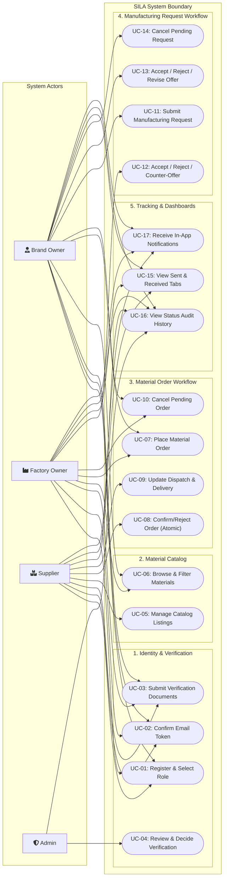

<!--
═══════════ HANDOFF ═══════════════════════════════════
Task:        T1.4 | Owner: P4 (QA & Business Analyst) | Status: DONE
What exists: Comprehensive Use Case Diagram (Mermaid) and 13 detailed Use Case Specifications covering Authentication, Verification, Catalog, Material Orders, Manufacturing Requests, and Sent/Received Dashboards.
What is left: // TODO(T4.1): Map test case scenarios to UC-01 through UC-13.
Depends on:  T1.1 (Data Model & Enums), T1.2 (Service Interfaces)
Used by:     All developers (P1, P2, P3, P4), Testers, Academic Reviewers
How to test: Verify all actors match Glossary (Brand Owner, Factory Owner, Supplier, Admin); ensure dual workflows are decoupled; verify D-01 through D-12 rules.
Notes:       All use cases enforce server-side validation and record-level authorization.
═══════════════════════════════════════════════════════
-->

# SILA (صِلة) — Use Case Analysis & Diagram

> **Document:** System Use Case Model & Detailed Specifications  
> **Task:** T1.4 | **Owner:** P4 (QA & Business Analyst)  
> **Academic Initiative:** DEPI — Full Stack .NET Track  
> **Last Updated:** 29 October 2026  

---

## 1. Actors & Stakeholders

The SILA system identifies five primary actors interacting with the boundary:

1. **Brand Owner:** Business entity designing apparel; submits manufacturing requests to factories; browses and purchases fabrics from suppliers.
2. **Factory Owner:** Garment manufacturing facility; receives, accepts, rejects, or counter-offers on manufacturing requests; purchases raw fabrics.
3. **Supplier:** Raw material vendor; maintains a catalog with stock and fixed pricing; confirms orders and updates dispatch/delivery.
4. **Buyer:** A composite role representing either a Brand Owner or a Factory Owner purchasing materials from a Supplier.
5. **Admin:** Internal administrative user provisioned via database seed; reviews business verification documents and approves or rejects accounts.

---

## 2. Mermaid Use Case Diagram

---

## 3. Detailed Use Case Specifications

### UC-01: Register & Select Role
- **Primary Actor:** Unregistered Visitor.
- **Preconditions:** User possesses an active email address and valid phone number.
- **Trigger:** User navigates to the Registration page and selects organization type.
- **Main Success Scenario:**
  1. User selects organization role (`Brand`, `Factory`, or `Supplier`).
  2. User enters Full Name, Email, Password, Phone Number, and Organization Name.
  3. System validates inputs against password complexity and unique email constraints.
  4. System atomically creates an `ApplicationUser` and an associated `Organization` record with `VerificationStatus = Unverified`.
  5. System generates an email verification token and queues an SMTP email.
  6. System displays an instructions screen: *"Check your email to activate your account."*
- **Alternative Flows:**
  - *4a. Email already registered:* System displays error: *"This email address is already in use."* Registration halts.
- **Postconditions:** User record created in database with `EmailConfirmed = false`; organization initialized as `Unverified`.

---

### UC-03: Submit Verification Documents & Admin Review
- **Primary Actors:** Unverified Organization User, Admin.
- **Preconditions:** User has confirmed email and logged in; organization is `Unverified`.
- **Main Success Scenario:**
  1. Organization navigates to Verification Profile.
  2. Depending on role, organization submits required proof:
     - *Supplier:* Commercial registration or tax certificate document (PDF/JPG/PNG, ≤ 5 MB).
     - *Factory:* Industrial operating license document and factory address.
     - *Brand:* Social media URL (Instagram/portfolio) and contact details.
  3. System stores documents outside source control and updates `VerificationStatus` to `PendingReview`.
  4. Admin logs into the Admin Verification Portal and inspects pending submissions.
  5. Admin reviews the proofs and clicks **Approve** with an optional note.
  6. System updates `VerificationStatus` to `Verified` and dispatches an in-app notification to the organization.
- **Alternative Flows:**
  - *5a. Admin Rejects submission:* Admin inputs a mandatory rejection reason and clicks **Reject**. System updates `VerificationStatus` to `Rejected` and notifies the organization.
- **Postconditions:** Organization is marked `Verified`, enabling creation of listings, orders, and requests.

---

### UC-05: Manage Catalog Listings
- **Primary Actor:** Verified Supplier.
- **Preconditions:** Supplier is logged in and possesses `VerificationStatus = Verified`.
- **Main Success Scenario:**
  1. Supplier accesses the Catalog Management dashboard.
  2. Supplier submits a new listing with: Name, Category, Description, Unit, Unit Price (> 0 EGP), and Available Quantity (≥ 0).
  3. System validates server-side and saves `MaterialListing` with a new `RowVersion` concurrency token.
  4. System displays the active catalog item.
- **Alternative Flows (Deactivation - BR-05):**
  - *2a. Supplier deactivates listing:* Supplier clicks **Deactivate**. System sets `IsActive = false`. Listing becomes hidden from public search; existing orders remain intact.
- **Postconditions:** Catalog listing is saved and visible to prospective buyers.

---

### UC-07: Place Material Order
- **Primary Actor:** Buyer (Verified Brand Owner or Factory Owner).
- **Preconditions:** Buyer is verified; active listings exist with `AvailableQuantity > 0`.
- **Main Success Scenario:**
  1. Buyer browses catalog and selects one or more items from a **single Supplier**.
  2. Buyer specifies desired quantities (positive whole integers).
  3. System validates that requested quantity $\le$ available stock for each listing.
  4. Buyer reviews order summary with frozen snapshot unit prices and total amount in EGP.
  5. Buyer submits order.
  6. System creates `MaterialOrder` (`PendingReview`) and `MaterialOrderLine` records capturing `MaterialNameSnapshot`, `UnitSnapshot`, and `UnitPriceSnapshot`.
  7. System dispatches an in-app notification to the target Supplier.
- **Alternative Flows:**
  - *1a. Items selected from multiple suppliers:* System alerts buyer: *"An order can only contain materials from one supplier. Please submit separate orders."* (BR-02).
- **Postconditions:** Order created in `PendingReview`; inventory is not yet deducted.

---

### UC-08: Confirm / Reject Order (Atomic Transaction)
- **Primary Actor:** Supplier.
- **Preconditions:** An order directed to the Supplier exists in `PendingReview`.
- **Main Success Scenario:**
  1. Supplier reviews pending order lines and quantities.
  2. Supplier clicks **Confirm Order**.
  3. In a single atomic database transaction:
     - System re-validates that `AvailableQuantity >= LineQuantity` for every line.
     - System decrements available quantities in `MaterialListings`.
     - System inserts `StockMovement` records.
     - System updates order status to `Confirmed`.
     - System appends a `StatusHistory` record.
  4. Transaction commits successfully.
  5. System sends an in-app notification to the Buyer.
- **Alternative Flows:**
  - *3a. Concurrent checkout depleted stock:* Another order depleted stock before this confirmation. Transaction rolls back entirely. System informs Supplier: *"Cannot confirm: insufficient stock for [Material Name]."* Order remains `PendingReview` (BR-03).
  - *2a. Supplier rejects order:* Supplier enters mandatory rejection reason and clicks **Reject**. Status transitions to `Rejected`. Stock is untouched.
- **Postconditions:** Order status is `Confirmed`; physical stock is atomically decremented.

---

### UC-11 & UC-12: Manufacturing Request Negotiation
- **Primary Actors:** Brand Owner, Factory Owner.
- **Preconditions:** Both Brand Owner and target Factory Owner are `Verified`.
- **Main Success Scenario:**
  1. Brand Owner submits request specifying product type, specs, fabric description, quantity (e.g., 100 units), and initial offer (e.g., 200 EGP/unit).
  2. System creates `ManufacturingRequest` (`PendingApproval`) and records Round 1 in `RequestOffer`.
  3. Factory Owner reviews request and decides price is too low; enters counter-offer of 250 EGP/unit with explanation.
  4. System transitions status to `CounterOffered`, logs Round 2 in `RequestOffer`, and notifies Brand Owner.
  5. Brand Owner reviews counter-offer and clicks **Accept**.
  6. System transitions status to `Accepted` (final).
  7. System records `StatusHistory` and notifies Factory Owner.
- **Alternative Flows (Revised Offer - D-11):**
  - *5a. Brand submits revised offer:* Brand counters with 230 EGP/unit. Status transitions back to `PendingApproval` with Round 3 recorded. Negotiation continues.
  - *5b. Either party rejects:* Status transitions to `Rejected` (final).
- **Postconditions:** Request reaches a final status (`Accepted` or `Rejected`) with full negotiation rounds preserved.

