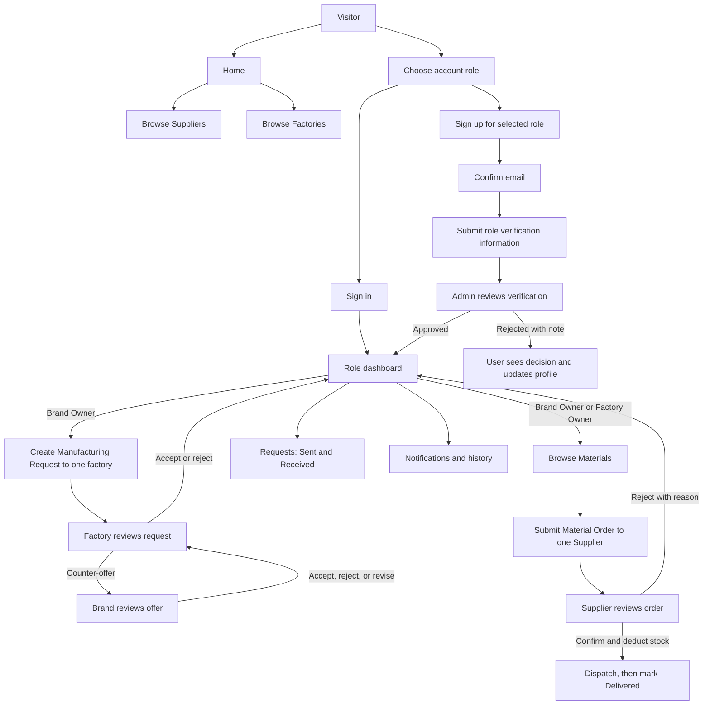

# SILA Wireframes and User Flow

**Task:** T1.3 · **Status:** low-fidelity page map · **Breakpoints:** desktop 1920×1080 / 1366×768, tablet 768×1024

Wireframes describe information hierarchy and primary actions, not final copy or data. `—` means a shared header/footer supplied by `_Layout`. Every authenticated screen retains role-aware navigation. Unverified accounts can browse and edit their own profile, but creation actions for listings, Material Orders and Manufacturing Requests are gated with a Pending Verification explanation.

## User Flow



Manufacturing Request and Material Order are independent flows. Accepting one never creates or confirms the other. Supplier pricing is fixed; price counter-offers exist only in Manufacturing Requests.

## Shared shell

```text
┌ SILA / ص                         [role links] [Notifications] [Profile] [Sign out] ┐
├───────────────────────────────────────────────────────────────────────────────────┤
│ Skip to content                                                                     │
│ Main content (centered responsive container)                                       │
├───────────────────────────────────────────────────────────────────────────────────┤
│ © 2026 SILA · Connecting Egypt’s fashion supply chain                         Privacy│
└───────────────────────────────────────────────────────────────────────────────────┘
```

On small screens the navigation collapses behind an accessible menu button. The primary page action stays visible near the page heading.

## Public and account pages

### Home — Browse Suppliers / Browse Factories

```text
┌──────────────────────────────────────────────────────────────────────┐
│ Eyebrow: SILA · Fashion supply network                                │
│ Find the right partner for your next collection                       │
│ Connect with verified factories and material suppliers across Egypt.  │
│ [Browse Suppliers] [Browse Factories]                                 │
│                                                                      │
│ How SILA connects the supply chain                                    │
│ [Find materials] [Send a Manufacturing Request] [Track decisions]    │
│ [Sign in]  New to SILA? [Create account]                              │
└──────────────────────────────────────────────────────────────────────┘
```

### Login role-choice page

```text
┌───────────────────────────────┐
│ Sign in to SILA               │
│ Choose your organization type │
│ ( ) Brand Owner               │
│ ( ) Factory Owner             │
│ ( ) Supplier                  │
│ [Continue to sign in]         │
│ New account? [Sign up]        │
└───────────────────────────────┘
```

Role choice is explicit and precedes credentials; the selected role is retained on the sign-in/sign-up screen and must agree with the account role server-side.

### Login

```text
┌───────────────────────────────┐
│ Sign in · [selected role]     │
│ Email address [____________]  │
│ Password      [____________]  │
│ [ ] Remember me               │
│ [Sign in]                     │
│ Email not confirmed? [Help]   │
│ New to SILA? [Create account] │
└───────────────────────────────┘
```

### Sign-up — Brand Owner

```text
┌ Create a Brand Owner account ─────────────────────────────────────────┐
│ Organization / brand name [________________]  Full name [___________] │
│ Email [________________________]  Contact number [________________]  │
│ Password [____________________]  Confirm password [________________] │
│ Instagram / proof link [___________________________________________] │
│ Previous work / portfolio [_______________________________________] │
│ [Create account]   Already registered? [Sign in]                      │
└──────────────────────────────────────────────────────────────────────┘
```

### Sign-up — Factory Owner

```text
┌ Create a Factory Owner account ───────────────────────────────────────┐
│ Factory name [________________]  Full name [_______________________] │
│ Email [________________________]  Password [_______________________] │
│ Factory location [_______________________________________________] │
│ Factory license [Choose file]  Accepted formats/size shown here      │
│ Confirm password [____________]                                      │
│ [Create account]   Already registered? [Sign in]                      │
└──────────────────────────────────────────────────────────────────────┘
```

### Sign-up — Supplier

```text
┌ Create a Supplier account ────────────────────────────────────────────┐
│ Supplier / organization name [____________]  Full name [___________] │
│ Email [________________________]  Password [_______________________] │
│ Supplier description [____________________________________________] │
│ Proof of supplier status [Choose file]  Accepted formats/size shown │
│ Confirm password [____________]                                      │
│ [Create account]   Already registered? [Sign in]                      │
└──────────────────────────────────────────────────────────────────────┘
```

After registration: confirmation-email instruction → email confirmation → submit any remaining verification information → PendingReview → Admin decision. Do not imply automatic verification.

## Role dashboards

All dashboards share a heading, verification banner if applicable, summary cards, pending work, latest notifications and shortcuts. Cards show counts only when supplied by the relevant dashboard service.

### Brand Owner Dashboard

```text
┌ Dashboard · [Brand name] · verification status ───────────────────────┐
│ [Requests awaiting factory] [Counter-offers to review] [Orders placed]│
│ Quick actions: [New Manufacturing Request] [Browse Materials]         │
│ Recent Manufacturing Requests (factory · product · offer · status)    │
│ Recent Material Orders (supplier · total · status)                    │
│ Latest notifications                                                  │
└──────────────────────────────────────────────────────────────────────┘
```

### Factory Owner Dashboard

```text
┌ Dashboard · [Factory name] · verification status ─────────────────────┐
│ [Requests to review] [Open offers] [Material Orders placed]          │
│ Quick actions: [Review requests] [Browse Materials]                  │
│ Incoming Manufacturing Requests (brand · product · quantity · offer) │
│ Recent Material Orders (supplier · total · status)                    │
│ Latest notifications                                                  │
└──────────────────────────────────────────────────────────────────────┘
```

### Supplier Dashboard

```text
┌ Dashboard · [Supplier name] · verification status ────────────────────┐
│ [Material Listings] [Orders to review] [Confirmed orders]             │
│ Quick actions: [Manage listings] [Review Material Orders]             │
│ Orders needing action (buyer · line count · total · status)           │
│ Low/out-of-stock listings (name · available quantity)                 │
│ Latest notifications                                                  │
└──────────────────────────────────────────────────────────────────────┘
```

## Organization Profiles

### Profile — Brand Owner

```text
┌ Brand profile · [verification badge] ─────────────────────────────────┐
│ [Brand name]  [Edit my profile]                                       │
│ About / brand description                                              │
│ Contact number · Instagram / proof link · Previous work / portfolio   │
│ Verification state and Admin note, when present                        │
└──────────────────────────────────────────────────────────────────────┘
```

### Profile — Factory Owner

```text
┌ Factory profile · [verification badge] ───────────────────────────────┐
│ [Factory name]  [Edit my profile]                                     │
│ Location · capabilities / description · factory license status       │
│ Verification state and Admin note, when present                        │
└──────────────────────────────────────────────────────────────────────┘
```

### Profile — Supplier

```text
┌ Supplier profile · [verification badge] ──────────────────────────────┐
│ [Supplier name]  [Edit my profile]                                    │
│ Description · materials supplied · contact information                │
│ Verification state and Admin note, when present                        │
└──────────────────────────────────────────────────────────────────────┘
```

## Catalog and orders

### Material Catalog / Browse Materials

```text
┌ Materials ────────────────────────────────────────────────────────────┐
│ Search [name or keyword________] Category [All v] [Search]            │
│ Results: [listing card] [listing card] [listing card]                  │
│ Card: name · Supplier · description · unit · EGP/unit · stock          │
│ [View / Add quantity]                 [Previous] 1 2 3 [Next]          │
└──────────────────────────────────────────────────────────────────────┘
```

For Supplier’s own catalog, add `[Add Material Listing]`, edit/deactivate actions, and the available quantity. At zero, show “Out of Stock”; do not allow adding it to an order. Empty results explain that no active listings match the search.

### Material Order summary

```text
┌ Review Material Order ────────────────────────────────────────────────┐
│ Supplier: [one supplier]                                              │
│ Item · unit price · quantity [−] [  ] [+] · line total                │
│ Item · unit price · quantity [−] [  ] [+] · line total                │
│ Total: EGP [amount]                                                   │
│ Price is fixed at the listed unit price.                              │
│ [Continue browsing]                              [Place Material Order]│
└──────────────────────────────────────────────────────────────────────┘
```

### Material Order details

```text
┌ Material Order #[id] · [MaterialOrderStatus] ─────────────────────────┐
│ Buyer ↔ Supplier · submitted date                                     │
│ Item snapshot · unit · unit price at order time · quantity · subtotal │
│ Total EGP [amount] · status history                                   │
│ Supplier actions: [Confirm] [Reject with reason] [Mark Dispatched]   │
│              [Mark Delivered] (only the action valid for current state)│
│ Buyer action: [Cancel] (only while PendingReview)                     │
└──────────────────────────────────────────────────────────────────────┘
```

### Manufacturing Request form

```text
┌ New Manufacturing Request ────────────────────────────────────────────┐
│ Target factory [verified factory v]                                   │
│ Product type [____________]  Quantity [________]                      │
│ Design specification [_____________________________________________] │
│ Material / fabric description [___________________________________] │
│ Offer price per unit (EGP) [________]  Notes [____________________] │
│ Attachment or link (optional) [___________________________________] │
│ [Save draft if supported]                          [Send request]     │
└──────────────────────────────────────────────────────────────────────┘
```

Only fields supported by the current implementation are shown; do not add unsupported workflow states such as production tracking.

### Manufacturing Request details with offers

```text
┌ Manufacturing Request #[id] · [ManufacturingRequestStatus] ──────────┐
│ Brand Owner → one target Factory · product · quantity                 │
│ Design/material details · notes · attachment/link                     │
│ Offer history: round · proposer · price/unit EGP · note · time        │
│ Factory actions while PendingApproval: [Accept] [Reject] [Counter-offer]│
│ Brand actions while CounterOffered: [Accept] [Reject] [Revise offer]  │
│ Brand may [Cancel] while request is pending.                          │
└──────────────────────────────────────────────────────────────────────┘
```

### Sent / Received Requests page

```text
┌ Requests ─────────────────────────────────────────────────────────────┐
│ [Sent] [Received]                                                     │
│ Type filter: [All | Manufacturing Request | Material Order]           │
│ Record · other party · date · workflow status · [View details]         │
│ Empty state tailored to selected tab; page controls below              │
└──────────────────────────────────────────────────────────────────────┘
```

Role contents: Brand Owner Sent = requests sent and orders placed; Factory Owner Received = requests addressed to its factory, Sent = orders placed; Supplier Received = orders received. Show each workflow’s status and history separately even when rows share a page.

## Notifications and Admin

### Notifications list

```text
┌ Notifications · [unread count] ───────────────────────────────────────┐
│ [Mark all read if supported]                                          │
│ Unread/read item · event · related record · date · [Open record]      │
│ Empty state: You’re all caught up.                                     │
└──────────────────────────────────────────────────────────────────────┘
```

Notifications are in-app only except account confirmation email. Notification copy identifies the event and record without mixing workflow states.

### Admin verification page

```text
┌ Verification review ─────────────────────────────────────────────────┐
│ [PendingReview organizations]                                         │
│ Organization · role · submitted date · evidence link/document         │
│ Select a record → organization profile and submitted evidence          │
│ Decision note [_______________________________________________]       │
│ [Approve] [Reject]                                                    │
└──────────────────────────────────────────────────────────────────────┘
```

Admin reviews evidence and records a decision; there is no Admin sign-up. Keep evidence private and avoid exposing another organization’s documents.

## Page coverage

The map covers Home/Browse entry points, role choice, Login, all three role-specific sign-up pages, all three dashboards, all three profile variants, Material Catalog, Material Order summary and details, Manufacturing Request form and details, Sent/Received, Notifications, and Admin verification. Browse Suppliers and Browse Factories use the shared searchable/paged directory pattern and verified organizations only.
