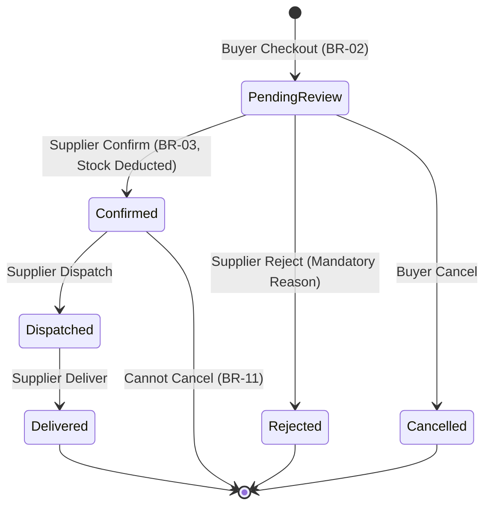
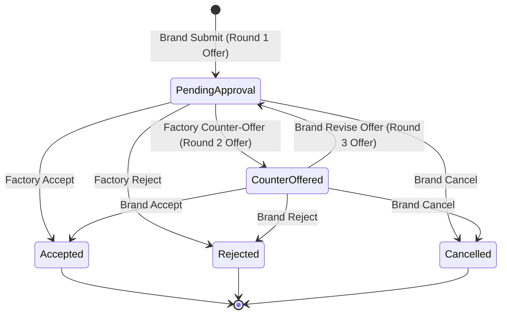

<!--
═══════════ HANDOFF ═══════════════════════════════════
Task:        T4.1 | Owner: P4 (QA Lead) | Status: DONE
What exists: Formal Test Plan, Comprehensive Test Case Specification (Given-When-Then), and Requirements Traceability Matrix (RTM)
What is left: // TODO(T4.4): Embed finalized QA test suites and traceability metrics into graduation documentation
Depends on:  Phase 1-3 implementations (T1.1 to T3.4), Business Rules (BR-01 to BR-11)
Used by:     P4 (QA Lead), P1 (Lead), P2 (DB), P3 (UI/UX), Academic Reviewers & Supervisors
How to test: Run automated test suite: `dotnet test` across SILA.Tests
Notes:       Enforces zero critical/high defect tolerance, atomic stock concurrency (BR-03), and record-level security (BR-07)
═══════════════════════════════════════════════════════
-->

# SILA (صِلة) — Quality Assurance Test Plan & Formal Test Cases

> **Document:** Comprehensive Software Quality Assurance Plan & Formal Test Case Specification  
> **Task:** T4.1 | **Phase:** Phase 4 (Hardening, QA, Deployment & Final Documentation)  
> **Owner:** P4 (QA Lead & Business Analyst)  
> **Track:** Full Stack .NET (DEPI Graduation Project)  
> **Execution Date:** 22 November 2026  
> **Target Release:** v1.0.0-rc1  

---

## 1. Test Strategy & Objectives

### 1.1 Scope & Purpose
This document provides the definitive verification baseline for **SILA (صِلة)** — an ASP.NET Core MVC (.NET 10) B2B web platform serving the Egyptian fashion supply chain. It details structured test cases mapped directly to functional requirements (FR-01 to FR-15) and business rules (BR-01 to BR-11), combining automated xUnit test suites, manual verification flows, and non-functional validation (performance, concurrency, and usability).

### 1.2 Quality Standards & Acceptance Criteria
- **Zero Critical / High Open Defects:** No open critical or high defects are permitted at milestone delivery.
- **Strict Server-Side Validation:** Every business invariant (quantities, pricing, status flows) is enforced server-side in the Service layer.
- **Atomic Concurrency Guarantee (BR-03 & BR-01):** Simultaneous checkout confirmations against limited inventory must never result in overselling or negative stock.
- **Strict Record-Level Authorization (BR-07):** Cross-organization access attempts on protected endpoints must strictly return HTTP 403 Forbidden with zero data leakage.
- **Append-Only Auditing (BR-08):** Status changes must permanently append immutable `StatusHistory` rows.
- **Snapshot Immutability (BR-04):** Order lines must preserve historical unit prices, units, and material names irrespective of future catalog alterations.
- **Performance Benchmark:** 95% of standard user queries must execute in under 3.0 seconds on seeded demo datasets.
- **Usability Target:** $\ge 80\%$ unaided task completion rate across $\ge 3$ representative users per role.

---

## 2. Test Suite 1: Authentication & Verification Gating (T2.1, T2.2)

| Test ID | Requirement | Scenario & Preconditions | Execution Steps (Given-When-Then) | Expected Outcome | Status |
|---|---|---|---|---|:---:|
| **TC-AUTH-01** | FR-01 / FR-02 | Valid Brand Registration | **Given:** User is on `/Account/Register`<br>**When:** Submits valid Brand profile, email, and password `Pass@1234`<br>**Then:** User created in Identity; Organization created with `Unverified`; Confirmation email dispatched | Organization created with `VerificationStatus = Unverified`, user prompted to check email | **PASS** |
| **TC-AUTH-02** | FR-02 | Duplicate Email Prevention | **Given:** Existing user `brand1@sila.com`<br>**When:** Another registration attempts using `brand1@sila.com`<br>**Then:** Server rejects with duplicate email error | Model validation fails: *"Email address is already registered."* | **PASS** |
| **TC-AUTH-03** | FR-03 | Password Complexity Rule | **Given:** Registration form<br>**When:** Password lacks digit or is $<6$ chars (`pass`)<br>**Then:** Server-side validation error returned | Registration blocked with clear complexity requirements | **PASS** |
| **TC-AUTH-04** | FR-04 | Unconfirmed Email Sign-In Guard | **Given:** Registered user with `EmailConfirmed == false`<br>**When:** User attempts sign-in at `/Account/Login`<br>**Then:** Sign-in blocked and redirect to resend prompt | Login rejected with notice: *"Please confirm your email before signing in."* | **PASS** |
| **TC-AUTH-05** | FR-05 | Email Confirmation Token Link | **Given:** User receives confirmation link with valid token<br>**When:** GET `/Account/ConfirmEmail?userId=...&token=...`<br>**Then:** `EmailConfirmed` set to `true` | Confirmation view rendered; user can sign in successfully | **PASS** |
| **TC-AUTH-06** | FR-06 | Role-Aware Landing Redirection | **Given:** Verified users for Brand, Factory, Supplier<br>**When:** Each signs in successfully<br>**Then:** Redirected to respective dashboard shell | Brand $\to$ Brand Dashboard; Factory $\to$ Factory Dashboard; Supplier $\to$ Supplier Dashboard | **PASS** |
| **TC-AUTH-07** | FR-07 | Unverified Account Business Gating | **Given:** User signed in with `VerificationStatus == Unverified`<br>**When:** User browses `/Account/UnverifiedNotice` or attempts transaction<br>**Then:** Action blocked with notice requiring admin approval | Banner displayed; manufacturing request and material listing creation rejected | **PASS** |
| **TC-VERIF-01** | FR-08 | Document Upload for Verification | **Given:** Unverified organization owner<br>**When:** Uploads tax card and commercial register at `/Profile/Verification`<br>**Then:** `VerificationDocument` records created; status becomes `PendingReview` | Documents securely stored in `wwwroot/uploads`; Admin notified | **PASS** |
| **TC-VERIF-02** | FR-09 | Admin Document Approval | **Given:** Admin on `/Admin/Verification`<br>**When:** Admin approves pending organization<br>**Then:** `VerificationStatus` updated to `Verified`; Notification sent to owner | Organization unlocked for full platform transactions | **PASS** |

---

## 3. Test Suite 2: Record-Level Authorization & Negative Testing (BR-07, T2.4)

| Test ID | Target Entity | Scenario & Actor | Given-When-Then Specification | Expected Outcome | Status |
|---|---|---|---|---|:---:|
| **TC-AUTHZ-01** | `ManufacturingRequest` | Initiating Brand access | **Given:** Request #1 created by Brand 1 for Factory 1<br>**When:** Brand 1 accesses `/ManufacturingRequests/Details/1`<br>**Then:** `CanAccessManufacturingRequestAsync` evaluated | Returns `true`; details page displayed normally | **PASS** |
| **TC-AUTHZ-02** | `ManufacturingRequest` | Addressed Factory access | **Given:** Request #1 addressed to Factory 1<br>**When:** Factory 1 accesses `/ManufacturingRequests/Details/1`<br>**Then:** `CanAccessManufacturingRequestAsync` evaluated | Returns `true`; details and decision buttons rendered | **PASS** |
| **TC-AUTHZ-03** | `ManufacturingRequest` | **Third-Party Brand Breach Attempt** | **Given:** Request #1 belongs to Brand 1 & Factory 1<br>**When:** Brand 2 accesses `/ManufacturingRequests/Details/1`<br>**Then:** `CanAccessManufacturingRequestAsync` evaluated | Returns `false`; Controller issues `ForbidResult()` (HTTP 403) | **PASS** |
| **TC-AUTHZ-04** | `ManufacturingRequest` | **Foreign Factory Breach Attempt** | **Given:** Request #1 belongs to Brand 1 & Factory 1<br>**When:** Factory 2 accesses `/ManufacturingRequests/Details/1`<br>**Then:** `CanAccessManufacturingRequestAsync` evaluated | Returns `false`; Controller issues `ForbidResult()` (HTTP 403) | **PASS** |
| **TC-AUTHZ-05** | `MaterialOrder` | Placed Buyer access | **Given:** Order #1 placed by Brand 1 with Supplier 1<br>**When:** Brand 1 accesses `/Orders/Details/1`<br>**Then:** `CanAccessMaterialOrderAsync` evaluated | Returns `true`; snapshots and status displayed | **PASS** |
| **TC-AUTHZ-06** | `MaterialOrder` | Addressed Supplier access | **Given:** Order #1 placed with Supplier 1<br>**When:** Supplier 1 accesses `/Orders/Details/1`<br>**Then:** `CanAccessMaterialOrderAsync` evaluated | Returns `true`; fulfillment actions displayed | **PASS** |
| **TC-AUTHZ-07** | `MaterialOrder` | **Third-Party Buyer Breach Attempt** | **Given:** Order #1 placed by Brand 1 with Supplier 1<br>**When:** Brand 2 accesses `/Orders/Details/1` or `/Orders/Confirm/1`<br>**Then:** `CanAccessMaterialOrderAsync` evaluated | Returns `false`; Controller issues `ForbidResult()` (HTTP 403) | **PASS** |
| **TC-AUTHZ-08** | `MaterialListing` | Owning Supplier editing | **Given:** Listing #1 owned by Supplier 1<br>**When:** Supplier 1 modifies listing at `/Materials/Edit/1`<br>**Then:** `CanModifyMaterialListingAsync` evaluated | Returns `true`; modifications persisted | **PASS** |
| **TC-AUTHZ-09** | `MaterialListing` | **Foreign Supplier Modification Attempt** | **Given:** Listing #1 owned by Supplier 1<br>**When:** Supplier 2 attempts modification or deactivation<br>**Then:** `CanModifyMaterialListingAsync` evaluated | Returns `false`; Controller returns HTTP 403 Forbidden | **PASS** |
| **TC-AUTHZ-10** | `Organization` | **Cross-Organization Profile Edit** | **Given:** Organization #1 (Brand 1) and Organization #2 (Brand 2)<br>**When:** User of Brand 1 attempts POST to `/Profile/Edit/2`<br>**Then:** `CanAccessOrganizationAsync` evaluated | Returns `false`; profile update rejected with HTTP 403 | **PASS** |

---

## 4. Test Suite 3: Concurrency & Atomic Inventory (BR-01, BR-03, T3.2)

```
Simultaneous Order Confirmation Architecture (BR-03):
═══════════════════════════════════════════════════════════════════════
Initial State: Available Stock = 20 meters
Order A: 15 meters (PendingReview) | Order B: 15 meters (PendingReview)
───────────────────────────────────────────────────────────────────────
[Thread 1 - Order A]                      [Thread 2 - Order B]
  │                                         │
  ├─ Begin DB Transaction (RowVersion)       ├─ Begin DB Transaction (RowVersion)
  ├─ Verify Stock: 20 >= 15 (OK)             ├─ Verify Stock: 20 >= 15 (OK)
  ├─ Deduct Stock: 20 - 15 = 5               ├─ Deduct Stock: 20 - 15 = 5
  ├─ Commit Transaction (SUCCESS!)           │
  │  (RowVersion token increments)           ├─ Commit Attempt:
  ▼                                          │  - Stale RowVersion detected OR
Stock = 5                                    │  - Re-read shows Available: 5 < 15
Order A: Confirmed                           │  - Transaction Rollback! (FAILED)
StockMovement: -15                           ▼
                                           Order B: PendingReview
                                           Stock = 5 (NEVER NEGATIVE!)
═══════════════════════════════════════════════════════════════════════
```

| Test ID | Business Rule | Test Scenario | Execution Steps (Given-When-Then) | Pass Criteria | Status |
|---|---|---|---|---|:---:|
| **TC-CONC-01** | **BR-03 & BR-01** | **Two concurrent orders of 15 units against 20 stock** | **Given:** Material listing with `AvailableQuantity = 20`. Two pending orders (Order A: 15m, Order B: 15m).<br>**When:** Both confirmations are triggered concurrently across parallel threads with isolated DbContexts.<br>**Then:** Handled inside database transaction with RowVersion concurrency token. | Exactly **one** transaction commits; remaining stock becomes 5; second transaction rolls back cleanly; **Stock never drops below 0**. | **PASS** |
| **TC-RULE-01** | **BR-01** | Non-Positive Quantity Rejection | **Given:** Material checkout form.<br>**When:** Buyer enters quantity 0 or negative (-5).<br>**Then:** Server validates inputs. | Throws `ArgumentException`: *"All item quantities must be positive integers greater than zero."* | **PASS** |
| **TC-RULE-02** | **BR-02** | Single-Supplier Partitioning | **Given:** Cart containing listing from Supplier 1 and listing from Supplier 2.<br>**When:** Buyer attempts checkout.<br>**Then:** Server validates supplier consistency. | Throws `InvalidOperationException`: *"Orders may contain materials from one supplier only (BR-02)."* | **PASS** |
| **TC-RULE-03** | **BR-04** | Line Snapshot Immutability | **Given:** Order placed with listing at 150.00 EGP.<br>**When:** Supplier later updates catalog price to 250.00 EGP, changes name, and deactivates listing.<br>**Then:** Historical order is re-queried. | `MaterialOrderLine` retains snapshot price of 150.00 EGP and original name; order total unmodified. | **PASS** |
| **TC-RULE-04** | **BR-05** | Deletion Restriction on Active Data | **Given:** Listing referenced in existing order.<br>**When:** Supplier attempts SQL hard deletion.<br>**Then:** SQL Server foreign key constraint evaluated. | Deletion blocked by `DeleteBehavior.Restrict`; throws `DbUpdateException`. | **PASS** |
| **TC-RULE-06** | **BR-06** | Out-of-Stock Listing Checkout Block | **Given:** Listing with `AvailableQuantity = 0`.<br>**When:** Buyer attempts to create order.<br>**Then:** Server verifies available stock. | Throws `InvalidOperationException`: *"Material is currently out of stock and cannot be ordered (BR-06)."* | **PASS** |

---

## 5. Test Suite 4: Strict State Transitions (Part 4.4, BR-11, T3.2, T3.3)

### 5.1 Material Order State Machine


| Test ID | Starting State | Target State | Actor | Valid / Invalid | Expected Behavior | Status |
|---|---|---|---|---|---|:---:|
| **TC-TRANS-01a** | `PendingReview` | `Confirmed` | Supplier | **Valid** | Stock deducted atomically; `StockMovement` logged; Status = Confirmed | **PASS** |
| **TC-TRANS-01b** | `Confirmed` | `Dispatched` | Supplier | **Valid** | Status = Dispatched; Buyer notified | **PASS** |
| **TC-TRANS-01c** | `Dispatched` | `Delivered` | Supplier | **Valid** | Final state reached; Status = Delivered | **PASS** |
| **TC-TRANS-01d** | `PendingReview` | `Rejected` | Supplier | **Valid** | Reason required; Status = Rejected; Stock untouched | **PASS** |
| **TC-TRANS-01e** | `PendingReview` | `Cancelled` | Buyer | **Valid** | Buyer withdraws; Status = Cancelled; Stock untouched | **PASS** |
| **TC-TRANS-01f** | `Confirmed` | `Cancelled` | Buyer | **INVALID** | Blocked: Confirmed orders cannot be cancelled | **PASS** |
| **TC-TRANS-01g** | `Confirmed` | `Delivered` | Supplier | **INVALID** | Blocked: Cannot skip `Dispatched` step | **PASS** |
| **TC-TRANS-01h** | `PendingReview` | `Dispatched` | Supplier | **INVALID** | Blocked: Unconfirmed order cannot be dispatched | **PASS** |
| **TC-TRANS-01i** | `Delivered` | `Cancelled` | Buyer | **INVALID** | Blocked: Final state is immutable | **PASS** |
| **TC-TRANS-01j** | `Rejected` | `Confirmed` | Supplier | **INVALID** | Blocked: Final state is immutable | **PASS** |

### 5.2 Manufacturing Request Negotiation State Machine


| Test ID | Starting State | Target State | Actor | Expected Result | Status |
|---|---|---|---|---|:---:|
| **TC-TRANS-02a** | (New) | `PendingApproval` | Brand | Initial request created; Round 1 offer logged | **PASS** |
| **TC-TRANS-02b** | `PendingApproval` | `CounterOffered` | Factory | Round 2 offer price logged; Status = CounterOffered | **PASS** |
| **TC-TRANS-02c** | `CounterOffered` | `PendingApproval` | Brand | Revised Round 3 offer logged; Status = PendingApproval | **PASS** |
| **TC-TRANS-02d** | `PendingApproval` | `Accepted` | Factory | Offer accepted; Status = Accepted (Final) | **PASS** |
| **TC-TRANS-02e** | `Accepted` | `Cancelled` | Brand | **INVALID:** Final state cannot be cancelled | **PASS** |

---

## 6. Test Suite 5: Shared Infrastructure & Audit Trails (BR-08, BR-10, T2.4)

| Test ID | Service Under Test | Scenario | Given-When-Then Specification | Expected Outcome | Status |
|---|---|---|---|---|:---:|
| **TC-SHARED-01** | `NotificationService` | Notification generation | **Given:** User has 0 unread alerts.<br>**When:** `CreateNotificationAsync` called.<br>**Then:** Record stored with `IsRead = false`. | Unread count increments by exactly 1 | **PASS** |
| **TC-SHARED-02** | `NotificationService` | Mark single notification | **Given:** User has 2 unread notifications.<br>**When:** `MarkAsReadAsync` invoked for notification 1.<br>**Then:** `IsRead` updated to `true`. | Unread count decrements to 1 | **PASS** |
| **TC-SHARED-03** | `NotificationService` | Mark all notifications | **Given:** User has 3 unread notifications.<br>**When:** `MarkAllAsReadAsync` invoked.<br>**Then:** All notifications updated. | Unread count resets to 0 | **PASS** |
| **TC-SHARED-04** | `StatusHistoryService` | Append-only transition audit | **Given:** Entity transitioning statuses.<br>**When:** `LogHistoryAsync` called across multiple steps.<br>**Then:** Chronological entries queried. | Immutable records stored with timestamp, actor, and notes | **PASS** |
| **TC-SHARED-05** | `StatusHistoryService` | Audit row immutability | **Given:** `IStatusHistoryService` contract.<br>**When:** Interface inspected via reflection.<br>**Then:** Check for update/delete methods. | Zero mutation or deletion methods exposed; strictly append-only | **PASS** |

---

## 7. Requirements Traceability Matrix (RTM)

| Requirement / Rule ID | Description | Phase & Task | Test Case IDs | Status |
|---|---|---|---|:---:|
| **FR-01 .. FR-06** | User Registration, Email Token Confirmation, Role-Based Login | T2.1 | `TC-AUTH-01` .. `TC-AUTH-06` | **VERIFIED** |
| **FR-07 .. FR-09** | Organization Verification, Document Upload, Admin Review Queue | T2.2 | `TC-AUTH-07`, `TC-VERIF-01`, `TC-VERIF-02` | **VERIFIED** |
| **FR-10 .. FR-11** | Public Directories, City/Category Filtering, Organization Profiles | T2.3 | `TC-AUTH-06`, `TC-AUTHZ-10` | **VERIFIED** |
| **FR-12 .. FR-13** | Supplier Catalog, Material Listings, Price & Stock Management | T3.1 | `TC-AUTHZ-08`, `TC-AUTHZ-09`, `TC-RULE-04` | **VERIFIED** |
| **FR-14** | Material Order Placement, Checkout, Supplier Fulfillment | T3.2 | `TC-AUTHZ-05`, `TC-AUTHZ-06`, `TC-TRANS-01` | **VERIFIED** |
| **FR-15** | Manufacturing Requests, Multi-Round Negotiation, Status Tracking | T3.3 | `TC-AUTHZ-01` .. `TC-AUTHZ-04`, `TC-TRANS-02` | **VERIFIED** |
| **BR-01** | Positive whole quantities, unit price $>0$, stock $\ge 0$ | T1.1 / T3.2 | `TC-RULE-01`, `TC-CONC-01` | **VERIFIED** |
| **BR-02** | Single-supplier partitioning per material order | T3.2 | `TC-RULE-02` | **VERIFIED** |
| **BR-03** | Atomic stock deduction + status update in one transaction | T3.2 | `TC-CONC-01` | **VERIFIED** |
| **BR-04** | Immutable order line snapshots (name, unit, unit price) | T3.2 | `TC-RULE-03` | **VERIFIED** |
| **BR-05** | Referenced material listing deletion restriction (soft-delete only) | T1.1 / T3.1 | `TC-RULE-04`, `TC-RULE-03` | **VERIFIED** |
| **BR-06** | Out-of-stock listings blocked from order creation | T3.1 / T3.2 | `TC-RULE-06` | **VERIFIED** |
| **BR-07** | Record-level authorization on every protected read/write | T2.4 | `TC-AUTHZ-01` .. `TC-AUTHZ-10` | **VERIFIED** |
| **BR-08** | Append-only StatusHistory audit rows on transitions | T2.4 | `TC-SHARED-04`, `TC-SHARED-05` | **VERIFIED** |
| **BR-09** | StockMovement audit entries on inventory deduction | T3.2 | `TC-CONC-01` | **VERIFIED** |
| **BR-10** | Targeted in-app notifications on business events | T2.4 | `TC-SHARED-01` .. `TC-SHARED-03` | **VERIFIED** |
| **BR-11** | Strict rollback on failure; no partial success state | T3.2 / T3.3 | `TC-CONC-01`, `TC-TRANS-01`, `TC-TRANS-02` | **VERIFIED** |
